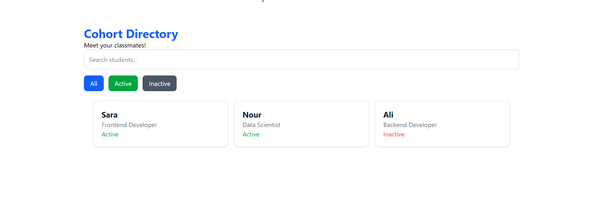

# Cohort Directory

A simple, responsive web application built with **React, TypeScript, and Tailwind CSS** as part of my self-directed learning journey in frontend development.

This project focuses on applying React fundamentals through hands-on practice, including reusable components, props, event handling, conditional rendering, and dynamic list rendering.

## Project Overview

Cohort Directory is a student directory application that allows users to browse members, search by name, and filter members based on their active or inactive status.

The goal of this project was to strengthen my understanding of React by applying the concepts I learned to a functional application.

## Application Preview



## Features

- **Member Directory:** Display student information, including name, role, and status.
- **Search Functionality:** Search for students by name with case-insensitive matching.
- **Status Filtering:** Filter students by All, Active, or Inactive.
- **Dynamic Rendering:** Display member cards using JavaScript's `map()` and `filter()` methods.
- **Conditional Rendering:** Show a helpful message when no students match the selected search or filter.
- **Responsive Design:** Adapt the member card layout to different screen sizes using Tailwind CSS.

## Technologies Used

- **React** — Component-based user interfaces
- **TypeScript** — Type-safe JavaScript development
- **Tailwind CSS** — Responsive styling
- **Vite** — Development environment and build tooling

## React Concepts Practiced

Through this project, I practiced:

- Creating and organizing reusable React components
- Passing data between components using props
- Using TypeScript to define component props
- Handling user interactions with `onChange` and `onClick`
- Managing UI state with the `useState` hook
- Rendering lists dynamically using `map()`
- Filtering data using `filter()`
- Applying conditional rendering with ternary operators
- Using Tailwind CSS utility classes for styling

## Project Structure

```text
src/
├── components/
│   ├── Header.tsx
│   ├── MemberCard.tsx
│   ├── MemberList.tsx
│   ├── SearchBar.tsx
│   ├── FilterBar.tsx
│   └── EmptyState.tsx
├── App.tsx
├── main.tsx
└── index.css
```

## Getting Started

Clone the repository:

```bash
git clone https://github.com/nourdarwish20/cohort-directory.git
```

Navigate to the project:

```bash
cd cohort-directory
```

Install dependencies:

```bash
npm install
```

Start the development server:

```bash
npm run dev
```

Open the local URL displayed in your terminal.

## Learning Journey

This project was developed as part of my independent study of React fundamentals, following practical exercises from a frontend development course.

Rather than focusing only on theoretical concepts, I used this application to practice implementing features, understanding component communication, and organizing code into reusable pieces.

It represents one of my hands-on steps toward strengthening my frontend development and software engineering skills.

---

**Project Type:** Self-Learning / Frontend Practice

**Author:** [Nour Darwish](https://github.com/nourdarwish20)
